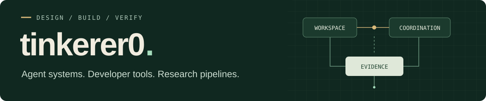

에이전트용 개발 환경, 다중 에이전트 조율 도구, 연구 파이프라인을 설계하고 만듭니다.

복잡한 개발·연구 작업을 실제로 사용할 수 있는 소프트웨어로 만드는 데 집중합니다.

[주요 프로젝트](#주요-프로젝트) &nbsp;·&nbsp; [공개 코드와 배포](#공개-코드와-배포) &nbsp;·&nbsp; [프로젝트 목록](docs/PROJECTS.md)

## 주요 프로젝트

<table>
<tr><th width="25%">시스템</th><th width="58%">직접 만드는 것</th><th width="17%">현재 단계</th></tr>
<tr>
<td><strong><a href="docs/systems/opeld.md">01 / Opeld →</a></strong> Agent workspace</td>
<td>사람과 여러 AI 코딩 도구를 한 작업 공간에서 사용할 수 있는 개발 환경을 직접 설계·개발합니다.</td>
<td>macOS 로컬 알파</td>
</tr>
<tr>
<td><strong><a href="docs/systems/research.md">02 / AI Scientist Lab →</a></strong> Research pipeline</td>
<td>연구 자료 검토, 분석 작업과 문서 작성을 지원하는 연구 소프트웨어를 설계·구현합니다.</td>
<td>연구 프로토타입</td>
</tr>
<tr>
<td><strong><a href="docs/systems/orchestration.md">03 / Agent Orchestration →</a></strong> Coordination &amp; verification</td>
<td>여러 AI 에이전트와 함께 실제 개발 작업을 진행하기 위한 협업 도구와 운영 체계를 만듭니다.</td>
<td>운영 중 지속 개선</td>
</tr>
</table>

세 시스템의 소스와 상세 구현은 비공개입니다. 링크에는 프로젝트의 목적, 직접 맡은 범위와 현재 상태만 소개합니다.

## 공개 코드와 배포

- **[done-contract](https://github.com/tinkerer0/done-contract)** — 코딩 에이전트의 완료 판정에 실제 검사 명령을 연결한 Python 도구. [설계](https://github.com/tinkerer0/done-contract/blob/main/DESIGN.md)·[테스트](https://github.com/tinkerer0/done-contract/tree/main/tests)·[비교 실험](https://github.com/tinkerer0/done-contract/tree/main/docs/evidence)을 공개했습니다. 현재 실험에서 효과가 입증되지 않았다는 결과도 함께 남겼습니다.
- **[MemoBuddy](https://github.com/tinkerer0/MemoBuddy)** — 데스크톱 펫에 글·그림 메모를 보관하는 앱. [Windows 배포](https://apps.microsoft.com/detail/9mv1clqjv6cx)와 [사용자 지원](https://github.com/tinkerer0/MemoBuddy/issues)을 운영합니다. 공개 저장소는 소개·지원 문서입니다.

## 그 밖의 작업

[데스크톱 앱·개발 도구](docs/PROJECTS.md) · [게임과 시각화 실험](docs/GAMES.md) · [보관한 스킬과 이전 공개판](docs/PROJECTS.md#보관된-스킬과-이전-공개판)

---

프로젝트의 목적과 개발 범위를 소개합니다. 비공개 소스와 상세 구현, 내부 실행 자료는 포함하지 않습니다. 
이 프로필의 문서는 <a href="LICENSE">MIT</a>를, 연결된 프로젝트는 각자의 라이선스를 따릅니다. <a href="assets/README.md">이미지 출처</a>.
